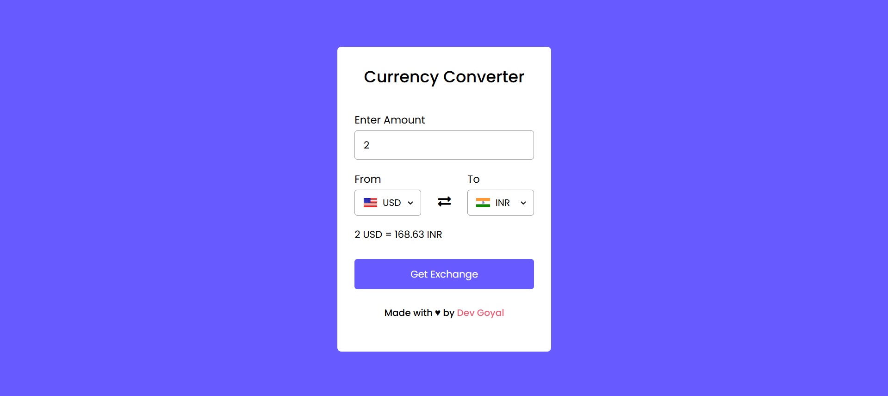

[](https://github.com/ummeazra0345)
[](https://github.com/ummeazra0345?tab=repositories)

<h1 align="center"> Currency Converter App </h1>

<p align="center"> <b> If you found this repository helpful, give it a ⭐️ </b> </p>

A lightweight and responsive web application that converts currencies using real-time market exchange rates. Built with vanilla JavaScript, it connects directly to a live exchange rate API to provide instant, precise conversions inside a clean, modern user interface.

## 🌐 Live Demo
Check out the live deployment here: [Currency Converter App](https://ummeazra0345.github.io/currency-converter-app/)

## 📸 Project Preview


## 🚀 Key Features
- **Live Market Rates:** Real-time exchange rate calculations powered by an external REST API.
- **Bi-directional Swapping:** Instant swap button to switch base and target currencies seamlessly.
- **Dynamic Selection:** Support for global currencies via intuitive selection menus.
- **Responsive Interface:** Optimized styling that looks great across mobile, tablet, and desktop viewports.
- **Accurate Display:** Shows both the final converted value and the exact unit exchange rate.

## 🛠️ Tech Stack
- **HTML5:** Semantic markup structure for converter controls and form elements.
- **CSS3:** Custom styles, modern Flexbox layout, and clean UI components.
- **JavaScript (ES6+):** Asynchronous API data fetching (`fetch`/`async-await`) and DOM event handling.

## 🧑‍💻 Getting Started Locally

Follow these steps to run the project on your local machine:

### 1. Prerequisites
Ensure you have [Git](https://git-scm.com/) installed on your machine.

### 2. Clone the Repository
```bash
git clone [https://github.com/ummeazra0345/currency-converter-app.git](https://github.com/ummeazra0345/currency-converter-app.git)
